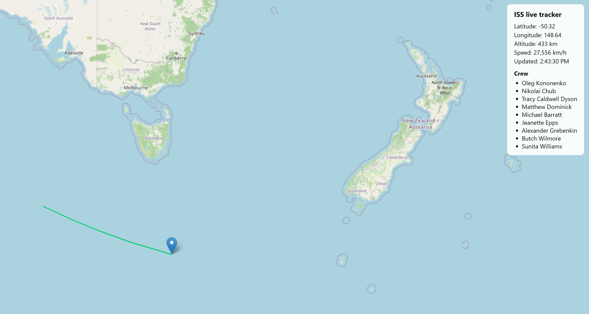

# ISS Live Tracker

A live world map showing the real-time position of the International Space Station, updating every 5 seconds, with its recent orbital trail and current stats.

**Live demo:** https://brettleevector-art.github.io/iss-tracker/



## What it does

- Plots the ISS's current latitude and longitude on an interactive map and moves the marker every 5 seconds
- Draws the recent orbital trail, split correctly where the ISS crosses the ±180° longitude line so no line streaks across the map
- Shows altitude, speed and last-updated time in a stats panel
- Lists the current ISS crew (see Known limits)
- Recovers from network or API errors and shows a retry message instead of crashing

## How it works

The browser calls the [Where the ISS at?](https://wheretheiss.at/w/developer) API every 5 seconds. Each response gives the ISS's position, altitude, velocity and a timestamp. The marker is created once and then moved with `setLatLng` on each update. The trail keeps the last 100 positions (about 8 minutes) and rebuilds its line segments on each update so the date-line jump never gets drawn.

There is no backend and no build step: plain HTML, CSS and JavaScript with [Leaflet](https://leafletjs.com/) for the map.

## Run it locally

No API keys are needed.

1. Clone the repo:
   ```
   git clone https://github.com/YOURNAME/iss-tracker.git
   cd iss-tracker
   ```
2. Open the folder in VS Code and install the **Live Server** extension.
3. Right-click `index.html` and choose **Open with Live Server**.

Any static file server works too, for example `python -m http.server 5500` and then open `http://localhost:5500`.

## Tech

- HTML, CSS, vanilla JavaScript
- [Leaflet](https://leafletjs.com/) 1.9.4 for the map
- [OpenStreetMap](https://www.openstreetmap.org/copyright) tiles
- [wheretheiss.at](https://wheretheiss.at/w/developer) API for position, altitude and speed
- [Open Notify](http://open-notify.org/) API for the crew list

## Known limits

- The crew list uses Open Notify, which only serves plain HTTP. Browsers block that request on an HTTPS site, so the deployed version shows "Crew list unavailable" (or a hardcoded list, if you replace it). Fixing it properly needs a small serverless proxy.
- The trail only covers the time since the page was opened. It does not load past positions.
- The ISS position comes from a third-party API. If that service is down or rate-limiting, the marker stops updating until it recovers.

## What I learned

- Why the marker is created once and then moved, instead of added on every update
- How the date line breaks a naive polyline, and how to split it into segments
- Why HTTP APIs break on HTTPS sites (mixed content) and why `.env` files don't hide keys in browser-only apps

## Possible next steps

- Next-visible-pass countdown for the viewer's location
- Browser notification when the ISS is about to pass overhead
- Serverless proxy for the crew data

## Credits

Position data: [wheretheiss.at](https://wheretheiss.at). Crew data: [Open Notify](http://open-notify.org/). Map tiles: &copy; OpenStreetMap contributors.
